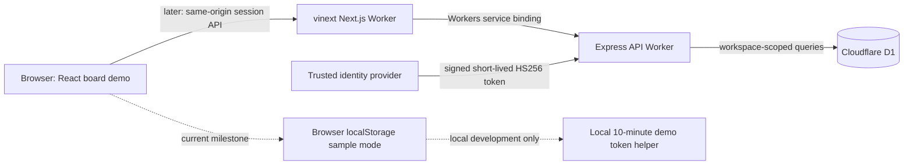

# LaunchPad architecture

The browser demo currently writes only to local storage. The API is separately implemented and requires a signed token plus a matching D1 workspace membership on every workspace route. The service binding and authenticated UI session are not connected yet. Production identity should come from a trusted identity provider; the local demo token helper must not ship to production.

D1 is the hosted demo database. The local stack can add PostgreSQL, Redis, Docker, and kind/Kubernetes labs as a separate reliability proof, with measured results and explicit environment boundaries.
